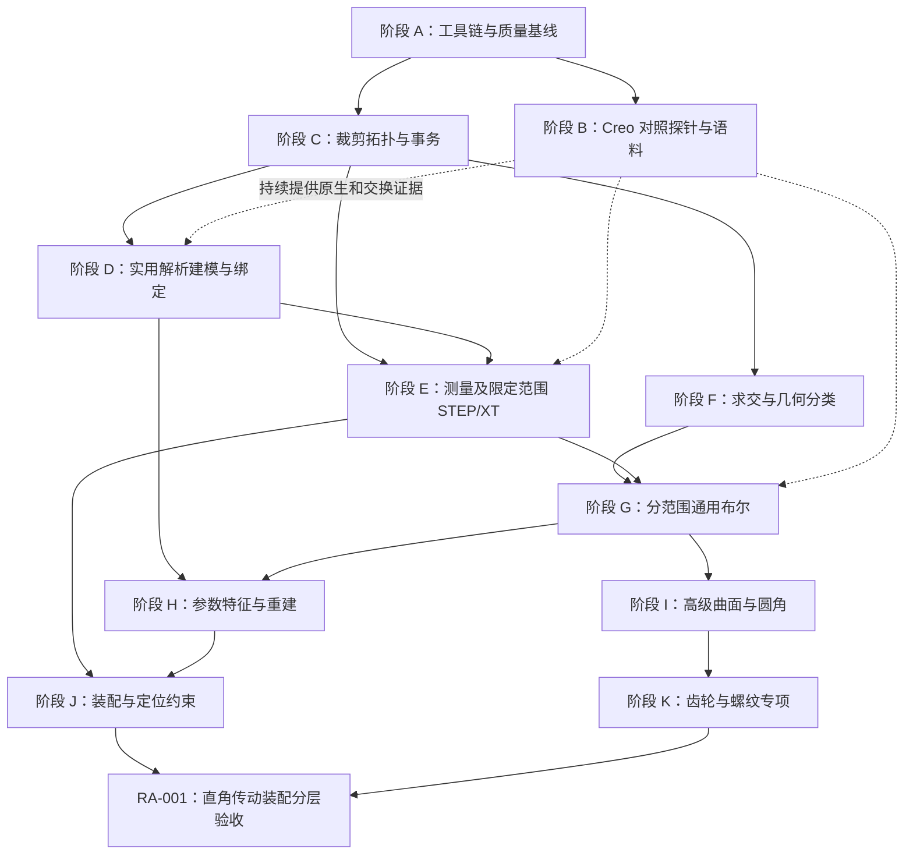

# Gensolid 开发计划：以自主内核为主，Creo 行为对照为辅

版本：1.2。编制日期：2026-10-13。状态：执行中。此次修订记录首批实现与验证结果，保留直角传动装配综合目标。

适用项目：`D:\CAD\liuxin\Gensolid`。本计划依据当前源码、项目 ADR、中心孔与偏置孔实验记录制定。文中的工期、语料数量和验收目标均为规划值；已经完成的能力单独标明。

## 执行进度（2026-10-13）

| 任务 | 当前结果 | 尚未完成的范围 |
|---|---|---|
| GS-001 | Linux/WSL 正式 stable 工具链可用；Rust 1.88 编译器工作空间检查通过 | 1.88 的 rustup 安装清单修复、Windows 本机构建 |
| GS-002 | 两处 NURBS Clippy 阻塞已修复，数值回归和全工作空间严格检查通过 | 本项已完成 |
| GS-003 | C 头文件/实际调用、Python 安装与测试、真实 WASM + Node 调用通过 | Windows、更多 Python 版本和浏览器运行验证 |
| GS-004 | 能力、支持域与错误契约文档已补齐 | 随新操作继续更新 |
| GS-005 | 配置化探针、UTF-8 事件、数值特征状态、哈希、超时和进程所有权清理已实现；三次 Creo 重放通过 | 原生特征属 GS-006；质量属性接口与内部精度采集继续排查 |
| GS-011 | 既有居中/偏心通孔的 C/Python/WASM 封装、C 版本化选项和绑定契约测试完成 | 新圆柱、多孔、盲孔、拉伸等操作的封装需随内核实现补齐 |

证据、复现命令和限制见 [首批开发执行报告](development-progress.zh-CN.md)；公开支持域见 [当前能力与错误契约](capabilities.zh-CN.md)。阶段 A 尚未达到全平台验收，阶段 B 尚未完成原生特征链。其他阶段仍按原依赖推进，RA-001 的各层目标未宣称完成。

## 1. 开发目标与路线

近期目标是形成一个能独立构造、检查、测量并交换常见机械零件的 Gensolid 内核。先完成板件、圆柱、孔、简单型材等可验证能力，再进入求交和通用布尔运算，随后发展特征重建、圆角和复杂曲面。

项目继续遵循现有方向：Rust 实现、解析 B-rep、Parasolid 风格的数据模型与 API、XT 一等支持、验证器优先。Creo 用于观察工业 CAD 的建模行为和交换结果；公开数学资料用于独立实现算法，OCP/OCCT 独立进程用于几何对拍。Creo 对照不会将 Gensolid 改造成依赖 Creo 的几何服务。

本计划的进度以可执行能力、可复现样例和验收结果衡量。恢复 Creo 源码不作为交付前提；现有证据也不能估算其核心代码的逆向成功百分比。

第一项可用交付建议为 **v0.2：解析机械零件内核**，范围包括基础实体、有限孔特征、质量属性、限定范围 STEP 交换、Python/C 调用及原生几何预览。v0.2 不承诺通用自由曲面布尔或复杂圆角。

### 1.1 综合目标：参考图中的直角传动装配

将用户提供的下图作为贯穿开发过程的综合验收对象，目标编号 **RA-001**，名称为“直角传动装配”。该名称用于项目跟踪；具体设备型号、传动形式和内部齿轮类型待设计资料确认。


参考图已归档至仓库文档目录。当前仅据图识别外壳、安装法兰、端盖、轴和紧固件等外观组成；尺寸、内部结构和配合关系均尚未确定，不能作为已经验证的工程数据。

最终目标是由 Gensolid 自身构造和管理该类装配中的自主设计零件，并提供参数重建、装配定位、测量、交换和预览。标准件可从有明确来源的模型导入并标注，不得将整个外部模型导入后展示，视为 Gensolid 已独立生成目标装配。

### 1.2 分层交付与验收

| 层级 | 交付目标 | 主要阶段依赖 | 验收条件 |
| --- | --- | --- | --- |
| RA-001-L1 外观近似模型 | 分别生成简化法兰、壳体、端盖、轴和紧固件，组合出接近参考图的外形 | D–G，以及J中的实例和固定定位基础 | 各自主构造零件为有效B-rep；能展示整体和拆分视图；明确标注假设尺寸、简化过渡和省略的内部结构 |
| RA-001-L2 参数化零件与装配 | 依据确认尺寸建立壳体空腔、轴承座、孔组、台阶、适用圆角、端盖及轴，建立装配定位 | H、I中所需圆角/抽壳能力、J | 关键尺寸与资料对应；修改孔径、孔距、轴径、壳体尺寸后零件及装配可重建；定位、配合、质量属性和STEP装配交换通过检查 |
| RA-001-L3 工程装配模型 | 在L2基础上加入确认的内部传动机构、选定标准件和所需真实螺纹 | J、K及已确认的设计资料 | 齿轮/传动形式、紧固件规格、配合公差有依据；预期接触与非预期干涉可区分；完整零件清单、装配结构和工程几何通过独立验收 |

每一层单独记录通过状态。外观相似不能代替尺寸验收，外壳完成不能代替内部传动完成，装配摆放不能代替装配约束。v0.2先交付可用于构造其简单子零件的能力，不以完整装配作为v0.2的发布前提。

### 1.3 零件拆分与资料准备

建议按“安装法兰→轴与端盖→壳体→装配定位→内部传动及工程配合”顺序迭代。内部传动零件在取得资料后再确定。

| 子目标 | 所需能力 | 关键验收项 |
| --- | --- | --- |
| 安装法兰 | 拉伸、多孔、沉孔、阶梯孔、有限范围倒角/圆角 | 外形尺寸、中心孔、孔距、孔深、安装基准 |
| 轴与端盖 | 回转、拉伸、布尔、孔组；键槽等按实图补充 | 轴径、台阶、配合面、同轴性、端盖厚度和螺栓位置 |
| 壳体 | 拉伸/回转、解析布尔、空腔/抽壳、圆角；必要时复杂曲面 | 壁厚、空腔、轴承座、轴线关系、端盖接口及有效性 |
| 紧固件与标准件 | 参数化简化件或有来源的标准件导入；必要时真实螺纹 | 规格、实例数量、定位、模型来源和简化等级 |
| 内部传动 | 已确认齿轮类型的参数化几何与装配关系 | 齿形参数、中心距、轴线关系、齿侧间隙和接触/干涉 |
| 整体装配 | 层级结构、实例变换、定位约束、参数重建和交换 | 零件身份、约束状态、BOM、质量属性、导出后结构与位置 |

实施L2/L3前应建立设计资料清单：型号或自拟设计规格、多视图/尺寸图、剖视和内部结构、孔与配合尺寸、公差、传动类型及参数、材料/密度、标准件规格。缺失资料先标为待确定；L1可使用显式声明的假设尺寸。资料补齐后重新验收，不把依据图片猜测的数值升级为实际尺寸。

## 2. 当前能力盘点

### 2.1 以实际源码为准的状态

| 领域 | 已有能力 | 当前缺口 | 下一步优先级 |
| --- | --- | --- | --- |
| 核心基础 | 类型化代际 ID、Arena、错误码、会话精度、局部容差 | 建模操作的完整事务、容量失败回滚、持久化约定 | P0 |
| 数学基础 | 点向量、坐标系、AABB、区间算术、`orient2d/orient3d` | 几何分类谓词、退化状态表达、世界坐标范围约束的完整验证 | P0/P1 |
| 几何表示 | 解析曲线曲面、NURBS、拉伸面、旋转面、求值求导 | 曲线/曲面求交、交线追踪、可证明的分支完整性 | P1 |
| 投影 | 直线/圆解析投影，部分几何的数值投影与距离计算 | 复杂几何全局最近点保证、裁剪面内投影、失败与误差界报告 | P1 |
| 拓扑 | body/region/shell/face/loop/fin/edge/vertex；表达非流形的结构 | 显式裁剪边区间、面参数曲线、周期接缝、受约束编辑及欧拉操作 | P0/P1 |
| 实体建模 | 长方体；中心及偏置圆柱通孔长方体 | 独立圆柱实体、多孔、盲孔、沉孔、实体拉伸/旋转 | P1 |
| 检查器 | 反向引用、环连接、流形边、部分点线面一致性检查 | 内外环包含与绕向、面内自交、实体自交、区域语义等更强检查 | 验证负责人安排 |
| 质量属性 | Demo 中有板件体积的参考公式 | 面积、实体体积、重心、惯性张量的内核计算 | P1 |
| XT | 文本头读写、节点流分词 | 真实文件验证、schema 解码、模型读写、二进制 XT | P1/P2 |
| STEP | 外部工具能生成和测量参考文件 | Gensolid 原生 STEP 读取与写出均未实现 | P1 |
| Rust API | 会话、整数 tag、基础查询、建模与检查 | 测量、变换、删除/复制、操作诊断、更多建模入口 | P1 |
| C/Python/WASM | 基础长方体和查询的绑定骨架 | 新通孔接口尚未封装；功能覆盖及错误语义一致性 | P1 |
| 特征与草绘 | 尚无原生特征系统 | 草绘约束、特征 DAG、参数重建、拓扑引用稳定性 | P2 |
| 装配 | 尚无原生装配系统 | 零件定义/实例、装配层级、定位约束、BOM及装配交换 | P2，RA-001目标所需 |
| 齿轮与螺纹 | 尚无专项参数化生成能力 | 确认传动类型的齿形、螺旋几何、标准参数及配合验证 | P2，RA-001-L3所需 |
| 可视化 | 外部参考/Creo STEP 可用 CAD Viewer 查看 | Gensolid 几何本身的显示网格、选择引用和测量预览 | P1/P2 |
| 评测设施 | 仓库策略测试与现有单元/属性测试 | 正式语料、自动对拍、性能基准及独立私有评测服务 | P0，验证负责人 |

优先级定义：P0 为后续开发前提或当前质量阻塞；P1 为首个可用交付所需；P2 为基础建模稳定后实施。

注意：已有圆柱曲面不等于已有圆柱实体；已有拉伸/旋转曲面不等于已有拉伸/旋转实体；数据结构允许非流形不等于已实现非流形布尔；XT 分词不等于 XT 模型导入。

### 2.2 最近一次实际验证基线

- 默认工作空间成员共 **63 项测试通过**，其中通孔集成/属性测试 10 项。
- 全项目格式检查通过；修改的 `gensolid-api`、`gensolid-topo` 通过严格 Clippy 检查。
- 全工作空间严格 Clippy 曾被 [nurbs.rs](/mnt/d/CAD/liuxin/Gensolid/crates/gensolid-geom/src/nurbs.rs:66) 的第 66、75 行既有循环警告阻挡。
- 本机 `stable` rustup 工具链不完整；最近构建显式使用 Rust 1.88 编译器和 rustdoc。此替代方式属于环境绕行，不能代替正式可复现工具链。
- 上述测试通过不代表 Python、WASM、各平台构建或远程 CI 已全部验证。测试数量本身也不是工业可靠性指标。

## 3. Creo 实验的证据与边界

### 3.1 已实际验证

| 试件 | 规格 | Gensolid 结果 | Creo 结果 |
| --- | --- | --- | --- |
| 中心通孔板 | 40×25×8 mm，Ø8，XY=(0,0) | 解析 B-rep 构造；检查通过 | 外部 STEP 导入、再生、保存、STEP 导出成功 |
| 偏置通孔板 | 40×25×8 mm，Ø8，XY=(6,-3) | 解析 B-rep 构造；位置/尺寸/方向检查通过 | 同样完成导入至导出流程；独立测量位置和孔半径吻合 |

共同观察：Gensolid 为 7 面/14 边，外部输入为 7 面/15 边，Creo 导出为 8 面/18 边。Creo 导出件含两个圆柱面；这是交换表示的观察结果，不能据此推断内部建模算法。

两次试件均由外部程序生成后导入 Creo，尚未在 Creo 中原生建立草绘、拉伸或孔特征。再生返回成功，但没有可靠枚举失败特征。质量属性请求返回 `XToolkitGeneralError`；报告中的 STEP 体积来自独立 OCP 计算，Gensolid 的体积输出来自参考公式。

### 3.2 证据对应的开发决策

| 观察 | 支持的开发决策 | 尚不能支持的结论 |
| --- | --- | --- |
| 孔位置、半径、包围盒在精度内一致 | 将两个试件纳入回归语料，继续独立实现解析孔特征 | 通用几何等价，或全部边界情况正确 |
| 面边数量发生变化 | 对拍应优先比较几何和区域语义，拓扑数量作诊断 | 必须强制复现 Creo 的 8 面/18 边 |
| STEP 出现单位换算 | 交换层显式处理单位及长度/面积/体积换算 | 可以直接比较文件中的原始数值 |
| 导入/再生/保存成功 | 将 Creo 作为交换兼容性测试端 | 原生孔特征的参数规则或内部算法已被验证 |
| 质量属性接口失败 | 单独修复探针并保留失败日志；继续独立测量 | 参考公式可冒充 Creo 或 Gensolid 的质量属性 |

证据文件与快照见[中心孔报告](/mnt/d/CAD/liuxin/Gensolid/docs/creo-comparison-demo.md)、[偏置孔报告](/mnt/d/CAD/liuxin/Gensolid/docs/creo-offset-hole-report.md)及[独立测量数据](/mnt/e/code/Rea-Test/creo_probe/offset_hole/measurements.json)。

## 4. 必须遵守的开发约束

执行规则以 [AGENTS.md](/mnt/d/CAD/liuxin/Gensolid/AGENTS.md) 和已采纳 ADR 为准：

1. 不修改受保护的 `verifier/`、`gensolid-check`、容差模块、`AGENTS.md`、`.github/`，不弱化测试断言。需要更强验证器或 CI 时，提交规格和失败样例，由其维护者实施、审核。
2. 几何阈值来自 `Precision` 或实体 `Tolerance`；拓扑判定使用精确谓词/区间算术，并记录显式容差回退。
3. 解析面保留解析表示；精确建模不能先转网格计算。网格仅作为后续显示和次级导出。
4. 内核库禁止 `unwrap/expect/panic/todo`；`unsafe` 仅限 FFI，并说明安全前提。
5. 每个新增建模操作均须通过 `check_body`，属性测试覆盖随机尺寸、坐标系及退化边界；无法执行的检查不能按成功处理。
6. 数据模型、公共 API 或流程变更先提交新的 ADR。保留 Parasolid 风格和 XT 一等功能的既有决策。
7. 按公开数学资料独立实现；外部内核通过独立进程提供对拍数据。不翻译或改写 OCCT 源码，不在 Gensolid 内核中链接其绑定。

编写本计划不改变上述受保护文件。下文列出的验证器/CI任务属于维护者工作项，不授权实现代理直接变更验证标准。

## 5. 目标架构与模块分工

保留现有分层；仅在职责稳定、接口经过 ADR 评审后拆分新 crate。下表的新名称为建议，不表示目录已经存在。

| 层/建议模块 | 责任 | 依赖约束 |
| --- | --- | --- |
| `gensolid-core/math` | ID、错误、精度、谓词、区间和基础变换 | 不依赖建模或交换层 |
| `gensolid-geom` | 几何求值、导数、参数域、解析/数值投影 | 不依赖拓扑与显示 |
| `gensolid-topo` | 拓扑表示、边/fin 参数关系、编辑事务和基础构造 | 不依赖网格或交换层 |
| 建议 `gensolid-intersect` | 曲线/曲面求交、分支和误差界 | 依赖 core/math/geom |
| 建议 `gensolid-model` | 实体构造、测量、分类、布尔、操作历史映射 | 依赖 topo/intersect；可调用 check，避免 topo↔check 循环 |
| `gensolid-xt`、建议 `gensolid-step` | 明确支持范围的模型读写、单位与诊断 | 导入构造后交给检查层验收；不依赖 GUI |
| 建议 `gensolid-mesh` | 从已验证 B-rep 生成显示网格及显示边 | 只做输出；建模内核不能反向依赖它 |
| 建议 `gensolid-feature` | 参数、特征 DAG、依赖重建、引用解析 | 在内核 API 之上；不成为布尔算法的前提 |
| 建议 `gensolid-assembly` | 零件定义和实例、层级变换、约束状态、BOM与装配测量 | 在实体/特征API之上；基本实例定位可先于约束求解实现 |
| 建议机械特征模块 | 齿轮、螺纹等参数化生成及标准参数处理 | 复用几何/建模能力；外部标准件保留导入来源，不替代自主建模验收 |
| `gensolid-api/ffi` 与绑定 | 统一会话、tag、错误和操作入口 | 绑定共享同一层语义，避免重复几何算法 |
| 外部 Creo 测试端 | 创建/导入、再生、保存、导出与日志采集 | Windows 上独立运行；Rust 核心测试不依赖 Creo 许可 |

数据模型 ADR 至少说明：裁剪边区间的方向、每个 fin 的二维参数曲线、周期缝的双重使用、退化边、内外环分类、操作后实体引用变化，以及 XT/STEP 对应方式。



## 6. 分阶段开发与验收

### 阶段 A：恢复可信开发基线

优先级 P0；关联原路线 M0；初估 1–2 人周。

工作：整理当前改动和来源；修复本机工具链并记录支持版本；在保持 NURBS 数值行为和测试断言的前提下修复既有 Clippy 阻塞；确认 MSRV、Windows/Linux 和各绑定构建；建立能力清单和错误分类规则。

交付：可复现构建说明、基线结果清单、已知失败列表、能力与支持范围表。CI 变更由受保护文件维护者执行。

验收：标准工具链运行格式检查、全工作空间严格 Clippy 和默认测试集全部通过；C 头文件生成验证、C 示例、Python 安装测试、WASM 构建分别留存结果。缺失任一平台验证时明确标记，不能写成全平台通过。

### 阶段 B：把 Creo 实验变成可复用对照能力

优先级 P0/P1；关联 M0；初估 2–4 人周，可与阶段 C 部分重叠。

工作：

- 将当前 [CreoProbe.java](/mnt/e/code/Rea-Test/creo_probe/CreoProbe.java) 改为参数驱动：独立输出目录、零件名称、输入文件和操作配置；统一 UTF-8 日志、明确枚举状态值、增加超时和异常分类。
- 明确区分启动、导入、建模、再生、保存、导出、连接关闭；关闭本次启动的进程，保留已有 Creo 会话。
- 调研当前安装的 J-Link/OTK/Toolkit 公共接口，先验证原生草绘、拉伸和孔特征的最小可行创建路径。优先公共 API；暂用可复现 trail/mapkey 时注明 UI 和版本依赖。
- 原生功能创建后记录参数、特征类型、实际状态、失败特征及再生结果。质量属性错误单独排查，测量单位和参考坐标系必须记录。
- 建立“外部导入往返”和“Creo 原生特征”两条测试链；运行接口探针和几何测量作为独立步骤。

交付：探针配置规格、可重放脚本、两个既有样例的标准记录，至少一个原生草绘→拉伸试件和一个原生孔试件，或明确的 SDK 能力阻塞报告。

验收：同一配置重复运行三次，得到一致的规格结论；日志足以分辨接口失败、建模失败和测量失败。若当前 SDK 无法自动创建原生特征，该项标为阻塞，不能用 STEP 导入替代原生特征验收；Gensolid 独立开发可继续。

### 阶段 C：补齐裁剪拓扑与事务

优先级 P0；关联 M1/M2；初估 4–8 人周。

工作：完成数据模型 ADR；表达边在三维曲线上的实际区间、fin 在面上的二维参数曲线、内外环及周期接缝；补齐参数映射、边拆分和环重建等基础编辑操作。引入建模事务或临时模型构造机制，覆盖几何与拓扑分配、已存在实体修改及 tag 发布。

同时明确世界坐标和尺寸盒的有效范围，处理局部坐标有效但变换后超界的输入。不得仅验证尺寸而忽略变换后坐标。

交付：版本化拓扑语义、编辑接口、事务机制、周期几何与参数关系回归集。

验收：现有长方体和两类通孔均保持正确；圆弧跨周期、同一接缝边被同面两次使用、不同方向 fin 的参数对应都有独立检查。注入分配/操作失败后，几何、拓扑和对外 tag 状态均不残留半成品；旧实体仍有效。新增检查器规则由验证负责人安排。

### 阶段 D：形成实用解析建模能力

优先级 P1；关联 M2；初估 4–8 人周。

建议按以下顺序实施，每项先限定支持域：

| 功能 | 初版支持范围 | 关键边界与验收 |
| --- | --- | --- |
| 独立圆柱实体 | 有限高度、解析平面端盖、圆柱侧面 | 两端方向、环连接、任意坐标系、近退化半径/高度 |
| 多个通孔 | 同轴向、孔互不相交且不接触外壁 | 孔间剩余材料、相切/重合/重叠拒绝、输入顺序不影响几何 |
| 盲孔 | 单侧、平底、沿局部 Z、深度小于板厚 | 孔底法向、封闭实体、剩余底厚；临界深度明确分类 |
| 沉孔/锪孔 | 同轴、有限台阶、规定入口侧 | 台阶内外环方向、深度/直径嵌套；不冒称真实螺纹 |
| 棱柱实体拉伸 | 简单平面闭合线段/圆弧轮廓；后续支持内环 | 轮廓自交、内环包含、封端、负向/双向拉伸 |
| 回转实体 | 简单轮廓、先完整回转，局部回转后续 | 轮廓穿轴、退化点、接缝、端盖；验证后扩展范围 |
| 刚体变换与复制 | 旋转和平移 | 几何、法向、参数关系及实体引用一致；缩放另立规格 |

圆柱与多孔/盲孔可继续作为专用构造入口，避免让它们冒充通用布尔。后续通用孔操作建立在成熟布尔与重建能力上，规格中区分二者。

每一功能同步加入 Rust API、C/Python 封装和版本化选项结构；WASM 按公开功能清单补齐。先为 Python/C 提供完整最小零件工作流，WASM 可按交付版本明确子集。

验收：支持域内的固定规格样例全部通过检查器和独立几何检查；尺寸/法向/孔深满足规格；属性测试覆盖尺寸、坐标系、边界。相同输入经各绑定得到相同几何与错误分类，C 内存所有权和空指针路径有专项验证。

### 阶段 E：测量、交换与真实 Gensolid 预览

优先级 P1；关联 M0/M2/M5；初估 6–12 人周。

工作分为三个可独立验收的子项：

1. **质量属性**：从真实裁剪 B-rep 计算面面积、实体体积和重心，再加入惯性张量。解析面尽量解析积分，其余使用有误差估计的曲面积分；不能用生成零件时的参数公式替代通用内核测量。计算真实包围盒，不能仅扫描顶点漏掉圆弧/曲面的极值。
2. **限定范围 STEP**：先实现线段/圆/圆弧、平面/圆柱及闭合流形实体所需的 Part 21 实体映射；明确单位、坐标变换、环和边方向及接缝。初版选择满足该子集的协议和实体集合，后续完善 AP242 能力。未知必需实体返回诊断，不能丢面后静默成功。
3. **XT 与显示**：收集可合法使用的真实 XT 文件，推进 schema 驱动的 `.x_t` 子集读取，与数据模型同步映射；二进制和写出后续安排。显示网格从已验证 Gensolid B-rep 生成，区分显示精度与建模精度，输出几何/拓扑选择映射。

交付：质量属性 API、STEP 支持清单与读写器、真实 XT 验证报告、Gensolid 自身的预览样例。

验收：建立 **Gensolid 构造→Gensolid 写出 STEP→独立读取测量→Creo 导入/再生/导出→再次独立测量** 的完整链。至少覆盖长方体、圆柱、中心/偏置孔、多孔、盲孔六类；记录单位、坐标和误差。质量属性由内核计算并与公式及独立测量交叉验证。真实 XT 只能在已声明 schema/实体子集内验收，未知内容要明确拒绝。

受限 STEP 能力提前用于对拍，不意味着取消原 M5 的完整交换路线；XT 仍是一等任务，不能被 Creo 试验挤出开发计划。

### 阶段 F：求交与几何分类

优先级 P1；关联 M1；初估 6–12 人周。

实施顺序：线/线、线/平面、圆/平面、平面/平面、平面/圆柱、圆柱/圆柱；随后拓展圆锥、球和 NURBS。区分离散交点、交线、相切、重合、无交和暂不能判定，不能将数值迭代不收敛等同于无交。

补齐点在裁剪面内和点在闭合实体内的分类，支持内部/外部/边界状态。数值求交需报告残差、参数区间、分支与误差界；边界分类统一使用既有精度政策。

验收：支持域内完整覆盖解析可解案例；验证交点/交线在双方几何上的残差、参数合法性、分支数和连续性。刚体变换不改变分类；交换输入和反向参数不改变几何解集。NURBS 数值求交另设范围和分支完整性门槛，不混入解析算法完成率。

### 阶段 G：逐级实现通用布尔运算

优先级 P1/P2；关联 M3；初估 10–20 人周，仅针对前两级支持域。

前提：阶段 C 的裁剪/事务、阶段 F 的求交/分类和阶段 E 的独立交换验证已达到各自门槛。

| 级别 | 支持域 | 典型回归用例 |
| --- | --- | --- |
| G1 | 平面边界的闭合流形实体，含任意刚体旋转 | 分离、包含、相交盒体、共享面、共享边/点 |
| G2 | 增加平面/圆柱等已支持解析曲面组合 | 板减圆柱孔、交叉孔、圆柱并/交/差 |
| G3 | 自由曲面、复杂容差和更广退化组合 | 裁剪 NURBS、复杂交线和近重合面 |
| G4 | 按既有数据模型扩展非流形/胞元结果 | 混合维度结果与多区域关系 |

核心流程为求交→分裂边面→分类→选择片段→重建区域/壳→检查。操作输入是否允许被修改须明确；默认采用返回新体的接口，保留来源映射。遇到不支持的有效输入返回 `Unsupported`，支持范围内尚无算法返回 `Unimplemented`，非法参数返回既有对应错误。

验收：每级支持域固定语料全部通过；结果几何与区域正确，不能以检查器零故障单独判定成功。验证并/交交换律、差的包含关系、体积守恒关系及刚体变换不变性。支持域内错误结果、超时、崩溃和错误拒绝均计为失败；G3/G4 不因 G1/G2 通过而宣称完成。

### 阶段 H：参数特征与重建

优先级 P2；与 M2/M6 及上层应用关联；初估 6–12 人周，先做最小特征 DAG。

工作：增加参数对象、单位、特征依赖和确定性重建；先支持基础体、拉伸、孔、刚体变换和已支持布尔。参考 Creo 的参数修改/再生行为制定规格，输出受影响特征、依赖关系、失败原因及可重试状态。

引用不能仅靠面边编号：结合操作来源映射、语义选择条件和几何判别。找不到或存在多个候选时明确失败，避免悄悄选错面。撤销/重做可先采用参数快照重放，不要求立刻复刻完整商业特征树。

验收：修改板厚、孔径和孔位置后，相关特征按依赖重建；无关输入保持语义稳定。特征删除、抑制、依赖丢失和失败回滚有明确行为。草绘约束求解器单独立项，不能以预先给定轮廓声称已支持自由参数草绘。

### 阶段 I：高级能力与工业范围扩展

优先级 P2；关联 M3/M4/M5/M6；需阶段性技术验证后再估工期。

建议顺序：有限范围直边倒角→简单恒定半径圆角→圆角链及拐角过渡→偏置/抽壳→扫掠/放样实体→更广 NURBS 求交和布尔→更完整 STEP/XT 模型交换。XT schema 建设持续进行，不等到本阶段才开始。

每项先规定支持的曲面、边连接和半径/厚度范围，再开放 API。复杂圆角、容差修复和自由曲面布尔不适合按短期固定日期承诺；先用失败语料验证算法路线，达标后扩展。

### 阶段 J：装配结构、定位与约束

优先级P2；作为现有M6之上的应用能力扩展；初版固定定位可在阶段D/E后启动，参数关联和约束依赖阶段H。工期在装配数据模型ADR和最小原型通过后另估。

工作：区分零件定义与零件实例，支持重复件、父子装配和层级坐标变换；先实现固定定位，再加入同轴、面重合/平行、距离和角度等声明范围内的约束。报告自由度、欠约束、冲突和求解失败，禁止通过隐式固定掩盖约束问题。用明确轴线定义RA-001的直角关系。

增加装配BOM、爆炸视图、刚体实例变换后的包围盒/质量属性，以及装配交换。质量属性在统一坐标系汇总，惯性计算包含旋转和平行轴处理；重复实例按实际数量计入，不能仅统计唯一零件定义。

交付：装配模型ADR、实例/定位/约束API、可重建装配样例、BOM、装配STEP及预览。

验收：同一零件多个实例可独立定位；层级变换组合正确；约束冲突有诊断；参数变更后实例与配合引用可重建。STEP往返后核对层级、实例数量、名称/身份映射和位置，不能仅验证导出为一个合并体。RA-001-L1使用简化件完成固定摆放；L2完成已声明定位约束和接口配合验证。

### 阶段 K：齿轮、螺纹与工程装配专项

优先级P2；RA-001-L3所需。先确认目标传动结构和标准规格，再决定支持域与工期。

齿轮专项先以参数明确的渐开线直齿轮建立独立回归样例，再按目标设计扩展。若目标为锥齿轮、螺旋锥齿轮或蜗杆机构，应分别规定齿面生成、轴线/中心距、齿侧间隙和啮合关系；简单直齿轮通过不代表已经支持目标的直角传动机构。

螺纹专项区分外观简化与真实螺旋几何：定义螺距、牙型、旋向、内外螺纹、长度及退刀结构；补齐螺旋曲线、扫掠和必要布尔能力，检验周期、封端与配合。简化圆柱/标注件不能作为真实螺纹生成能力验收。

轴承、紧固件等标准件优先按确认规格使用参数化模型或有来源的CAD文件。工程配合使用确认的公差和接触语义；区分设计允许的接触、齿侧间隙和非预期穿透，不能用“所有零件绝对分离”作为统一干涉规则。

交付：所支持齿轮和螺纹参数规格、独立几何回归集、标准件来源清单、目标内部结构及配合检查报告。

验收：各自主设计零件通过完整B-rep检查及独立尺寸/齿形/螺纹测量；装配满足确认的轴线、中心距和配合规格。RA-001-L3在资料、零件和装配均满足定义后通过；未取得内部结构资料时保持待验证状态。

## 7. Creo 对照测试设计

### 7.1 两条独立证据链

**交换链**：已知参考 STEP→Creo 导入→再生→保存/导出→独立测量。主要验证文件兼容、单位和几何保持。

**原生特征链**：操作规格→Creo 原生特征创建→参数修改/再生→记录失败状态→导出/测量；相同规格在 Gensolid 独立执行。主要观察功能语义、范围、重建和失败行为。

Creo 无法启动或缺少相应 SDK 能力时，记录外部条件阻塞，不把该次运行计入几何成功率，也不把它改写成 Gensolid 的建模失败。对拍完成率另行报告。

### 7.2 样例矩阵

| 类别 | 需要覆盖的配置 | 可观测结果 |
| --- | --- | --- |
| 基础体 | 长方体/圆柱，平移/旋转，小尺寸至尺寸盒附近 | 包围盒、面积、体积、重心、方向、有效实体 |
| 通孔 | 中心/偏置/多孔，孔间隙及外壁间隙边界 | 孔轴、半径、贯穿范围、原生特征接受/拒绝 |
| 盲孔/沉孔 | 深度变化、不同入口侧、近贯穿与底厚边界 | 实际底面、台阶深度、再生状态 |
| 拉伸/回转 | 内环、圆弧、方向翻转、局部回转 | 体积/形状、接缝、封端、输入有效性 |
| 布尔 | 分离、包含、相交、相切、共面、随机旋转 | 区域、连通分量、体积关系、错误分类 |
| 重建 | 孔径/板厚修改、依赖删除、无效参数再恢复 | 特征状态、依赖、引用稳定性及恢复行为 |
| 交换 | 毫米/英寸，坐标变换，周期面，多个实体 | 单位归一化、几何保持、诊断和支持范围 |
| RA-001子零件 | 法兰、轴、端盖、壳体，简化和工程几何分开 | 各件参数/尺寸、空腔/壁厚、圆角、重建与交换 |
| RA-001装配 | 重复紧固件、层级变换、同轴/直角关系、参数修改 | 实例数、定位约束、BOM、干涉/接触、装配STEP往返 |
| 齿轮/螺纹 | 已确认类型、规格、旋向与配合 | 独立参数检查和几何测量；不以简化外观替代验收 |

每类先建立小型命名用例，再加入固定种子参数扫描。规划在 v0.2 前形成至少 50 个命名样例；布尔 G2 前形成至少 200 个覆盖不同关系的样例。这些数量不代表当前已完成。

### 7.3 每次实验必须保存的记录

记录包含：样例 ID、操作规格版本、参数和单位、坐标系、`Precision`、随机种子、Creo/SDK 版本、Gensolid 提交/补丁摘要、运行平台、输入输出 SHA-256、耗时、日志、失败阶段、可用测量及快照路径。

Creo 特征类型和状态需输出可解析枚举值，不能保留当前 Java 对象地址作为成功依据。未取得某项测量时置为缺失并附原因，不填写参考公式伪装成功。

现有试件位于 `E:\code\Rea-Test\creo_probe`，与 Gensolid 仓库分离。阶段 B 应定义显式语料根目录并提供清单；在验证维护者审核前，不把这份本地目录直接视为正式评测语料。

## 8. 几何验收与质量标准

### 8.1 每项建模能力的完成定义

必须同时满足：支持域与错误行为有文档；输出通过 `check_body` 且无未执行的检查；规格尺寸与区域语义正确；独立解析/对拍验证通过；随机和退化测试通过；事务失败不污染模型；公开 API 与所声明绑定可用；示例、中文说明、来源声明完整。

检查器通过是必要条件，不是形状正确的充分条件。当前边内部采样不能证明整条交线在曲面上，拓扑一致性也不能排除错误内外环、重复壳或自交体；这些风险需增加独立检查或由验证维护者扩充验证标准。

### 8.2 误差与比较方法

- 比较长度、孔位置和包围盒前统一单位与坐标系。线性阈值依据模型 `Precision` 和导入实体容差。
- 面积和体积误差采用具有正确量纲的预算：由表面积、边界尺度、线性容差及积分误差推导，不能直接把长度精度拿来当体积阈值。系数由基准实验预先确定并记录，不能失败后临时放宽。
- 质量属性、圆柱轴位置和孔深均从真实输出几何读取；公式作为另一条独立参照。
- 不要求面边数量等于 Creo。比较连通区域、边界位置、曲面参数和测量；必要时做双向距离检查。采样距离仅是支持证据，不能冒充全局等价证明。
- 周期接缝、顶点缺省及不同分面方式采用明确的规范化规则。Euler 关系按完整拓扑语义计算，不能对带孔面/周期面机械套用 `V-E+F=2`。

### 8.3 测试、覆盖率与性能

规划每个建模操作在日常验证中运行不少于 256 组固定可复现属性样例；阶段验收再运行不少于 10,000 组跨种子样例，并保留最小失败输入。有效随机输入与无效边界输入分别统计。

支持域固定语料要求全部通过。随机“成功率”的分母预先冻结，支持域内的超时、崩溃、`Unsupported` 和几何错误都计失败。域外正确拒绝另报，不用于抬高建模成功率。

性能记录固定硬件、构建参数、规模和线程设置，统计耗时中位数/P95、峰值内存及容差增长。先记录基线再设预算，不承诺无测量依据的“达到 Creo 速度的百分之多少”。

正式 oracle、私有语料及评分服务由验证负责人维护；实现代理只依据允许公开的用例、诊断和评分改进算法。

## 9. 接口与错误语义

| 情况 | 行为 |
| --- | --- |
| 参数非法、NaN/Inf、轴无效、规格外的孔位置 | 返回相应参数/退化错误，保留原模型 |
| 有效输入超出明确设计支持域 | `Unsupported`，说明不支持的几何类别或关系 |
| 规格范围内尚缺算法 | `Unimplemented`，不能返回未经验证的结果 |
| 文件实体、schema 或单位无法解码 | 文件诊断包含实体/节点位置，禁止静默丢失必需数据 |
| 输出检查失败 | 操作失败并回滚，附诊断；不把无效体作为成功 tag 返回 |
| 特征引用丢失/歧义 | 明确重建失败，不自动选任意候选 |
| 数值求交未收敛 | 返回有上下文的失败结果，不能当作无交 |

新增状态应通过 ADR 决定如何映射到既有错误码，不擅自改变已作为 C ABI 的数值。绑定不得把错误转成空模型、空集合或成功布尔值。

## 10. 优先任务清单

以下为建议工作项，编号可直接用于后续任务跟踪；未标记“已有”的均待执行。

| 编号 | 任务 | 优先级 | 前置 | 完成证据 | 责任角色 |
| --- | --- | --- | --- | --- | --- |
| GS-001 | 标准工具链和本机基线恢复 | P0 | 无 | 标准命令日志、版本清单 | 构建/集成 |
| GS-002 | 修复现有 NURBS Clippy 警告 | P0 | GS-001 | 数值回归不变、严格 Clippy 通过 | 几何开发 |
| GS-003 | 全绑定/多平台现状验证 | P0 | GS-001/002 | 分平台和分绑定结果 | 集成，CI维护者 |
| GS-004 | 能力和错误契约文档 | P0 | 当前源码审计 | 支持域清单与案例 | 内核负责人 |
| GS-005 | Creo 探针配置、状态及日志标准化 | P0 | 两个已有试件 | 三次可重放日志 | Creo测试集成 |
| GS-006 | Creo 原生草绘/拉伸/孔可行性 | P1 | GS-005 | 原生特征证据或阻塞报告 | Creo测试集成 |
| GS-007 | 裁剪区间/p-curve/接缝 ADR | P0 | GS-004 | 审核后的数据模型决策 | 内核负责人 |
| GS-008 | 编辑事务与错误回滚 | P0 | GS-007 | 注入失败后的状态验证 | 拓扑开发 |
| GS-009 | 参数映射与基础拓扑编辑 | P1 | GS-007/008 | 周期、方向、拆分回归 | 拓扑开发 |
| GS-010 | 圆柱实体、多通孔、盲孔 | P1 | GS-008/009 | 真 B-rep、随机/边界验证 | 建模开发 |
| GS-011 | 通孔及新操作 C/Python/WASM 封装 | P1 | 操作规格稳定 | 绑定一致性与C内存测试 | 绑定开发 |
| GS-012 | 真实包围盒、面积、体积、重心 | P1 | 裁剪表示及基础体 | 独立几何测量对照 | 几何开发 |
| GS-013 | 限定解析 STEP 写出与读取 | P1 | GS-009 | Creo 往返及拒绝诊断 | 交换开发 |
| GS-014 | 真实 XT 语料和 schema 子集 | P1 | 模型 ADR | 节点映射及真实文件报告 | 交换，验证负责人 |
| GS-015 | Gensolid 显示网格和引用映射 | P1 | GS-009/010 | 自身几何可视化 | 显示/应用 |
| GS-016 | 解析求交与内外分类 | P1 | GS-009 | 分支/残差/分类验证 | 几何开发 |
| GS-017 | 平面实体布尔 G1 | P1 | GS-008/013/016 | 共面/包含/旋转回归 | 建模开发 |
| GS-018 | 解析曲面布尔 G2 | P1/P2 | GS-017及所需求交 | 孔、交叉圆柱结果 | 建模开发 |
| GS-019 | 参数特征 DAG 与引用恢复 | P2 | 基础API，后接GS-018 | 参数修改/失败恢复演示 | 特征开发 |
| GS-020 | 正式 oracle/语料/性能评分 | P0，贯穿 | 规格与公开失败样例 | 独立评测结果 | 验证负责人 |
| GS-021 | 简单倒角/恒定圆角技术验证 | P2 | GS-018 | 明确支持域的失败/成功集 | 几何/建模 |
| GS-022 | RA-001设计资料、假设与分层规格 | P1 | 用户参考图，GS-004 | 子零件清单、待定尺寸/内部结构和各层验收规格 | 产品/机械设计 |
| GS-023 | RA-001法兰、轴、端盖、壳体逐件样例 | P1/P2 | GS-010/018/019/021按各件所需能力，GS-022 | 自主生成的B-rep、参数、测量与对照报告 | 建模/测试集成 |
| GS-024 | 装配定义、实例和层级变换 | P2 | 装配ADR，GS-010/013 | 重复件与固定定位测试，RA-001-L1组合模型 | 装配开发 |
| GS-025 | 装配定位约束与参数重建 | P2 | GS-019/024 | 同轴/直角定位、自由度/冲突报告，L2重建 | 装配/特征开发 |
| GS-026 | 目标齿轮类型及齿形专项 | P2 | GS-022及所需扫掠/曲面/布尔能力 | 确认规格的齿形、轴线、间隙与接触验证 | 几何/机械设计 |
| GS-027 | 真实螺纹与标准件管理 | P2 | 确认规格，阶段I所需螺旋/扫掠/布尔 | 内外螺纹回归、标准件来源与配合检查 | 机械特征开发 |
| GS-028 | 装配BOM、测量与STEP交换 | P2 | GS-012/013/024 | 实例统计、惯性汇总、结构/位置往返验证 | 装配/交换开发 |
| GS-029 | RA-001-L1/L2/L3分层综合验收 | P1/P2按层级 | GS-022–028中对应层所需项 | 分层检查报告；完整工程装配需资料与专项均达标 | 独立验证/集成 |

## 11. 最初四周的执行安排

这是启动顺序建议，假设至少两名能持续投入的内核开发人员，并有测试集成支持。单人执行时按依赖顺序延长；不为了日期跳过验收。

| 时间 | 内核主线 | Creo/验证主线 | 交付检查点 |
| --- | --- | --- | --- |
| 第1周 | 工具链、Clippy、绑定基线；冻结能力清单 | 整理两试件和实验配置；建立RA-001资料/假设清单 | 可以重现现有63项测试；明确质量阻塞及综合目标资料缺口 |
| 第2周 | 裁剪/事务ADR与最小事务原型 | 标准化探针；完成原生拉伸/孔最小可行性调查 | 评审拓扑方案；明确原生Creo能力是否可用 |
| 第3周 | 实施事务和参数关系基础；圆柱构造原型 | 新增圆柱及孔深/壁厚边界规格；提交验证规则需求 | 展示失败不污染模型；新构造仅在已验证范围发布 |
| 第4周 | 参数关系/接缝回归；确定多孔、盲孔及绑定切片 | 原生和交换链首轮矩阵；整理RA-001法兰子目标及失败用例 | 形成v0.2详细迭代清单，重估阶段C–E工作量及装配专项 |

若阶段 C 未达到门槛，第3–4周的新构造只作为实验原型，不提前将通用布尔或 STEP 导入标记完成。

## 12. 人力、工期与版本规划

建议配置：两名内核开发人员，其中一人偏几何/数值，一人偏拓扑/建模；0.5–1 名测试与交换集成人员；验证标准由独立维护者负责。角色可由同一人兼任，但时间需按实际投入计算。

阶段 A–E 初估合计 **17–34 人周**，不含额外的正式验证设施工作；部分阶段可重叠，但不能按人数简单相除。上述配置下，v0.2 可用交付暂按 **3–6 个月**安排评估窗口，第四周依据原生 Creo 接口和拓扑实现情况重估。这是预估，不是上线承诺。

| 建议版本 | 内容 | 发布条件 |
| --- | --- | --- |
| v0.1.x 开发迭代 | 基线修复、探针规范、已有通孔绑定 | 质量门槛恢复、能力范围真实可查 |
| v0.2 解析机械零件 | 阶段C–E的受限基础建模、测量、交换与预览 | 支持域内固定语料全部通过；真正Gensolid STEP可独立打开 |
| v0.3 受限通用布尔 | G1/G2求交、分类、区域重建 | 对拍、边界回归、事务与错误行为达标 |
| v0.4 参数建模切片 | 特征DAG、参数再生、稳定引用策略 | 代表性零件可修改参数并重建，失败可恢复 |
| 装配能力版本，版本号待定 | 阶段J，RA-001-L1/L2按所需几何能力推进 | 自主子零件、实例/约束/重建、BOM和装配交换通过分层验收 |
| 工程装配版本，版本号待定 | 阶段K与RA-001-L3 | 内部结构资料确认，目标齿轮/螺纹、工程配合及整体独立验证达标 |
| 后续内核版本 | 更广NURBS、圆角、偏置、完整交换 | 对应算法专项技术验证与独立基准达标 |

自由曲面布尔和工业级圆角可能需要长期专项投入；本计划不将其工期隐藏在 v0.2 内。AI 可协助实现、语料和回归整理，但不能按代理数量线性压缩数值算法的验证工作。

阶段J/K、目标所需的高级壳体能力及RA-001工程资料准备不包含在阶段A–E的17–34人周或v0.2的3–6个月估算中。综合目标增加了装配与机械专项工作，须在资料和技术范围确定后单独估算，并安排机械设计及装配开发角色。

## 13. 主要风险与处理方式

| 风险 | 触发信号 | 处理方式 |
| --- | --- | --- |
| 专用原语误当通用建模 | 只有板减同轴圆柱案例，却宣称布尔完成 | 按支持域和G1/G2分别验收；专用入口保留明确名称 |
| 检查器漏掉语义错误 | 零故障但孔壁方向/区域错误 | 独立解析检查、对拍、由维护者补强规则 |
| 接缝和裁剪数据不足 | 跨周期圆弧、同面双fin无法表达 | 阶段C先完成ADR和表示，再推进交换/布尔 |
| 分配失败遗留模型 | 操作失败后几何或tag数量改变 | 事务、临时构造及失败注入；控制发布时点 |
| Creo SDK/会话条件不满足 | 原生创建缺失、质量属性持续异常 | 单独标记外部阻塞；独立oracle支持内核开发，不虚构Creo结论 |
| 单位和误差预算错误 | 几何似乎相同而体积/孔径差一个比例 | 显式单位、量纲正确的阈值及完整误差记录 |
| 为对拍强行改变正确拓扑 | 追求8面/18边导致重复面/伪接缝 | 几何与区域语义优先，拓扑数量只作诊断 |
| XT被STEP挤出计划 | 没有真实XT或schema任务 | GS-014与数据模型并行，发布报告单列XT状态 |
| 工具链和本机配置掩盖问题 | 只能靠临时二进制运行 | 阶段A恢复正式工具链及跨平台验证 |
| 大功能过早扩大支持域 | 数值失败增加，成功率口径被调整 | 缩小到公开支持域、保留失败输入，再按门槛扩展 |
| 图片不足以确定工程结构 | 无尺寸/剖视/齿轮与配合资料 | L1明确假设，L2/L3设置资料验收门槛；保留待定项 |
| 外观完成被当作装配完成 | 仅摆放外壳，内部传动和约束缺失 | RA-001三个层级分别验收，列明自主生成件和导入标准件 |
| 新增目标挤占v0.2或隐含工期 | 以原3–6个月承诺完整减速装配 | 阶段J/K及高级壳体另估，分层交付并更新资源安排 |

## 14. 交付、评审与更新

每个迭代提交：规格/ADR、实现、属性与回归样例、绑定变化、运行命令、中文结果报告和已知限制。输出新 CAD 文件时同时提供有效性检查、规格测量、保存快照及可用预览入口。

发布前运行现有必需命令，并完成变动相关的绑定和交换验证：

```sh
cargo fmt --all --check
cargo clippy --workspace --all-targets -- -D warnings
cargo test
```

C 接口变更后按仓库要求重新生成并验证头文件；Python/WASM 和多平台工作流分别留存结果。涉及受保护的验证器/CI内容时，由对应维护者评审和实施。

计划每两周核对一次能力清单与失败语料，每阶段结束更新验收结果和下一阶段工期。只有对应操作、绑定和支持域实际验证后，才将状态从“计划/实验”改为“已支持”。

## 15. 计划依据

- [项目中文说明与原M0–M6路线](/mnt/d/CAD/liuxin/Gensolid/README.zh-CN.md)
- [代理开发规则](/mnt/d/CAD/liuxin/Gensolid/AGENTS.md)
- [数据模型ADR](/mnt/d/CAD/liuxin/Gensolid/docs/adr/0003-parasolid-data-model.md)
- [容差与精确谓词ADR](/mnt/d/CAD/liuxin/Gensolid/docs/adr/0004-tolerance-and-exact-predicates.md)
- [XT一等功能ADR](/mnt/d/CAD/liuxin/Gensolid/docs/adr/0005-xt-first-class.md)
- [验证器优先ADR](/mnt/d/CAD/liuxin/Gensolid/docs/adr/0006-verification-first-rsi.md)
- [代码来源ADR](/mnt/d/CAD/liuxin/Gensolid/docs/adr/0007-references-and-provenance.md)
- [验证设施现状](/mnt/d/CAD/liuxin/Gensolid/verifier/README.md)
- [中心孔对照报告](/mnt/d/CAD/liuxin/Gensolid/docs/creo-comparison-demo.md)
- [偏置孔对照报告](/mnt/d/CAD/liuxin/Gensolid/docs/creo-offset-hole-report.md)
- [用户提供的RA-001参考图](/mnt/d/CAD/liuxin/Gensolid/docs/assets/right-angle-drive-reference.png)
